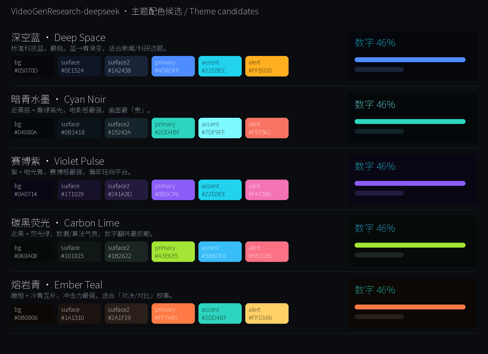

# 主题配色与界面设计 / Theme palettes and UI design

> **什么时候加载**：做视觉蒙皮、调色、改主题 token、需要向他人说明配色依据时。
> 色卡图：[01_theme_swatches.png](01_theme_swatches.png)（由 `scripts/make_palette_swatch.py` 生成，
> 机器可读副本 [01_theme_swatches.json](01_theme_swatches.json)）。

## 1. 重要前提：模板的配色**不能直接继承**

实测 `video-shotcraft/template` 的 Ink Press 模板风格是**米白衬线编辑风**
（`_smoke_still.png` 取样：底 `#F7F5F2`、衬线大字、字距拉开的等宽副行、一个琥珀色光标块）。

而 video-shotcraft 的 SKILL.md 明确要求：

> 走模板或镜头卡路线时，**只继承其镜头结构、运动语法、节奏和已调参数；
> 字体、排版、配色与材质必须按目标产品重新蒙皮。**

本项目目标是**科技感 / 电影感**，所以：**借它的运镜与节奏，视觉全部重做。**

## 2. 五套候选主题



| id | 名称 | 底 | 主强调 | 次强调 | 气质 |
|---|---|---|---|---|---|
| **`cyan-noir`** ⭐ | 暗青水墨 | `#04080A` | `#2DD4BF` | `#7DF9FF` | 近黑+青绿，电影感最强、画面最「贵」 |
| `deep-space` | 深空蓝 | `#05070D` | `#4D8DFF` | `#22D3EE` | 标准科技蓝，最稳，适合新闻/科研 |
| `violet-pulse` | 赛博紫 | `#0A0714` | `#8B5CF6` | `#22D3EE` | 紫+电光青，赛博感最强，偏年轻向 |
| `carbon-lime` | 碳黑荧光 | `#060A08` | `#A3E635` | `#38BDF8` | 近黑+荧光绿，数据/算法气质，数字最抓眼 |
| `ember-teal` | 熔岩青 | `#0B0806` | `#FF7A45` | `#2DD4BF` | 暖橙+冷青互补，冲击力最强，适合「对比」叙事 |

### 本项目选定：`cyan-noir`

理由：

1. **衬托白底图表**：素材里 4 张（`04` 论文首页 / `05` 架构图 / `06` 动作图 / `08` 性能曲线）
   都是**白底学术图**。深青底 + 白底图卡做成「发光面板」时对比最自然，
   而暖色底（`ember-teal`）会让白底图显脏。
2. **不与素材撞色**：机器人草坪是绿色、Science Robotics logo 是红色、
   图表曲线是深蓝/青。`cyan-noir` 的青绿主色与草坪同色系但更冷更亮，能「融进去再跳出来」；
   若用 `violet-pulse` 的紫，会与蓝色曲线打架。
3. **电影感**：近黑底（`#04080A`）比纯黑（`#000000`）更有层次，
   在 H.264 暗部不易出现色带。

## 3. 设计 token（`cyan-noir` 定稿）

```jsonc
{
  "bg":        "#04080A",   // 全局底 / global background
  "surface":   "#0B1418",   // 卡片面 / card surface
  "surface2":  "#15242A",   // 次级面、轨道、进度底 / secondary surface, tracks
  "primary":   "#2DD4BF",   // 主强调：数字、进度条、主标题点缀 / primary accent
  "accent":    "#7DF9FF",   // 次强调：高光、描边、关键数字 / secondary accent
  "alert":     "#F97362",   // 警示/对比色：规则系统、代价段 / alert
  "text":      "#E8F1F2",   // 正文
  "textMuted": "#7A8C90",   // 次要文字、来源标注
  "border":    "#1E3138"    // 描边
}
```

### 3.1 使用规则

| token | 用在哪 | 不要用在哪 |
|---|---|---|
| `bg` | 全局底 | 大面积纯黑 `#000`（暗部色带） |
| `surface` / `surface2` | 承载白底图表的卡片、进度轨道 | 大色块铺满（会显闷） |
| `primary` | **每屏只出现 1–2 处**：主数字、主进度、主标题关键词 | 满屏描边高亮（廉价） |
| `accent` | 高光、单点光效、**锁定数字** | 群发泛光（SKILL.md：装饰性 glint 群发即廉价） |
| `alert` | 只用于「对比/劣势/代价」语义（如 Rule-based 青→此处用 `alert`） | 装饰 |

### 3.2 白底学术图的处理规范（**本项目的关键设计决策**）

素材 `04/05/06/07/08` 是白底图，直接贴深底会「发光刺眼」。统一处理：

1. **卡片化承载**：白底图放进 `rounded-2xl` 卡片，卡片带 `border: 1px solid border`
   + 轻微外阴影 + 极淡内发光 —— 让它是「一块屏幕」而不是「一块白」；
2. **轻微压暗**：图整体 `filter: brightness(0.92) contrast(1.05)`，避免与深底反差过冲；
3. **图内标注用原色**：图里的英文标签（Goal / Policy / 25Hz…）**保留原样**，
   不要再叠中文长句；中文解读放到**图外的字幕条**；
4. **高亮用 `primary`/`accent` 描边覆盖**，不改图本身像素
   （改图会产生不可复现的外部处理步骤）。

## 4. 字体

| 用途 | 字体 | 来源 | 理由 |
|---|---|---|---|
| 中文全部 | **Noto Sans SC VF**（思源黑体可变） | `assets/fonts/NotoSansSC-VF.ttf` | ⭐ TTF 格式，`@font-face` 可靠；可变字重 100–900 一个文件覆盖；**OFL 免署名可商用** |
| 数字/指标 | 同字体 + `font-variation-settings: 'wght' 800` | 同上 | 大数字需要重字重；避免引入第二个字体增加体积 |

**禁止**使用 `msyh.ttc` 等 **TTC 集合**字体 —— `@font-face` 取 face 不可靠且**静默 fallback**，
详见 [../issues/002-cjk-font-ttc-face-ambiguity.md](../issues/002-cjk-font-ttc-face-ambiguity.md)。

**字体必须等加载完成再渲染**：用 `delayRender()` / `continueRender()` 包裹，
否则首帧会用 fallback 字体（不报错，只是不对）。

## 5. 版式与安全区

数值见 [00_platform_output_spec.md](00_platform_output_spec.md) §4（**唯一权威处**，本文不重复）。

设计含义：

- **竖屏**：底部 420px 不能放字 → 主画面居中偏上，字幕条固定在 `y ≈ 1400` 附近；
  安全框 `x ∈ [60, 900]`、`y ∈ [120, 1500]`。
- **横屏**：相对宽松，字幕条在 `y ≈ 880`；安全框 `x ∈ [80, 1840]`、`y ∈ [60, 940]`。
- **同一套镜头组件**按 `useVideoConfig()` 的 `width/height` 分支出版式，
  **不用等比缩放**（1920×1080 缩到 1080 宽会得到 1080×608，不是 9:16）。

## 6. 复现方式

```powershell
# 重新生成色卡（改配色后跑这个）
& "C:\Users\75203\miniforge3\envs\ov_env_py312\python.exe" `
    VideoGenResearch-deepseek\scripts\make_palette_swatch.py
```

输出：`01_theme_swatches.png`（人工看）+ `01_theme_swatches.json`（机器读，供 Remotion 主题文件生成）。
